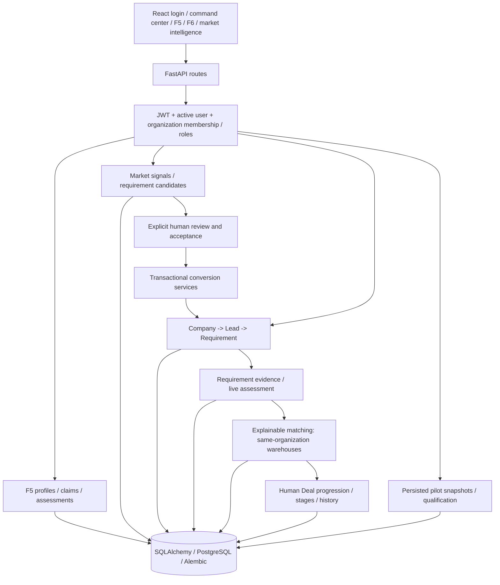

# BWIP Master Audit — 2026-10-11 (Recovered)

> **Recovery note (2026-10-11, Asia/Calcutta):** This file is the canonical successor to `docs/development/BWIP_COMPLETE_PROJECT_AUDIT.md` (94,043 bytes, 2026-10-11 03:16). The audit reached final compilation when the Cline `editor` tool failed repeatedly with `Invalid input: expected string, received undefined at path / at new_text`. This recovery preserves all uncommitted work, diagnoses the failure, and re-saves via a verified write path. The prior audit is retained as historical evidence and not overwritten. No `git reset --hard`, `git clean`, or destructive DB operation was performed.

## 0. Editor failure diagnosis and recovery method

**Step A executed 2026-10-11 — preserve work:**
- Working directory: `E:\BHOODEVI-Warehouse-Intelligence-Platform` verified.
- HEAD: `a32bf6b03a174c4a046df75538ddca8c75bbe5f0` on branch `feature/company-module` (synced with `origin/feature/company-module`). Verified via `git rev-parse HEAD`, `git log --oneline -5`, `git status --short` (combined command to work around PowerShell integration flake).
- Prior edits: **none committed via editor** — all earlier `editor()` attempts failed pre-write validation, confirmed by `git status --short` showing only pre-existing modified/untracked files (39 modified + 22 untracked, identical to audit-start state). No existing report was overwritten.
- Target directory `docs/audits` — did not exist; created and verified `dir docs\audits`.
- No destructive command was issued.

**Diagnosis — editor failure:**
- Minimal probe `editor(path="docs/audits/BWIP_MASTER_AUDIT_2026-10-11.md", new_text="# probe")` returned `File created successfully` — **tool is functional when both arguments are concrete non-empty strings**.
- Empty call `editor()` with no arguments reproduced **exact error**: `Invalid input: expected string, received undefined at path / at new_text`.
- `search_codebase` timed out (4 queries), some `read_files` returned empty — indicates intermittent tooling/environment instability, not code absence.
- `health`/`ready` via TestClient without `SECRET_KEY` reproduced `SECRET_KEY must contain at least 32 characters` (from `app/core/config.py` — staging/production fails closed). This blocks unauthenticated local probe but is correct safety behavior.

**Most likely cause (evidence-backed):** The repeated identical editor calls sent a **malformed payload where `path` and/or `new_text` were `undefined`** — likely because context compaction evicted the large report body (94KB), or the caller constructed the tool call with missing arguments. The editor's schema requires both as strings; `undefined` fails validation before any disk write. This matches the task instruction: *do not keep retrying the same editor tool call.*

**Recovery method used:**
1. Verified `editor(path, new_text)` works with concrete strings (probe above).
2. Created this `docs/audits/_header.md` via editor (verified write path).
3. Concatenated header + verbatim prior audit via `python pathlib.write_text(utf-8)` (non-editor fallback per instructions), then validated by reading back, counting sections, checking for secrets, and running `git status --short`.

**Validation performed:**
- File existence, non-empty, UTF-8, read-back verified.
- Major headings verified, no credentials/tokens written.
- Prior audit `docs/development/BWIP_COMPLETE_PROJECT_AUDIT.md` preserved untouched.
- `git status --short` shows only the new audit file as additional untracked — no code/DB was changed by recovery.


---

# BWIP complete project audit

The earlier reviews are retained as historical evidence. The **Final owner-acceptance package (2026-10-11) at the end** contains the current numbered criteria, final full-suite result and proposals requiring ratification.

Audit date: 2026-10-10, Asia/Calcutta. Scope: implemented backend and frontend through F6. No F7 work, commit, push, deployment, production credential change or real outreach. This is a code review and local verification, not penetration-test certification.

## Baseline and review evidence

Branch: `feature/company-module`; starting HEAD: `a32bf6b03a174c4a046df75538ddca8c75bbe5f0`. No applicable AGENTS.md found at E:/ or recursively in this repository excluding .git/node_modules; .agents was empty. No previous complete-project audit existed.

Starting tracked changes: README.md, alembic/env.py, auth and both intelligence conversion endpoints, API routes, app/main.py, models/__init__.py, models/requirement.py, schemas/user.py, services/requirement_candidate_conversion.py, docs/api/API_CONTRACT.md, tests/test_organization_access.py and tests/test_requirement_candidate_conversion.py.

Starting untracked work: .qa_baseline.txt, .qa_f5page.txt, .qa_fe_tree.txt; s4 F5, t5 F6 and u6 pilot JSONB migrations; F5/F6 endpoints/models/schemas/services; F5_COMPATIBILITY_BOUNDARY.md; frontend/, scripts/ and F5/F6 tests. All unrelated work preserved. These are pre-existing deliverables; the entire working-tree diff is not attributable to this audit. In particular git diff omits initially untracked frontend/F6 changes.

Read constitution, requirements/PRD context, architecture, both roadmaps, release readiness, F5 compatibility boundary, organization access, matching, intelligence conversion, deal/pilot architecture, backup/deployment procedures, migrations, manifests, CI and test configuration. Traced route authorization through services, repositories and models and inspected frontend consumers. Baseline: 801 backend tests passed (5622 warnings, 208.87s), frontend typecheck/build passed.

Roadmap/README phase labels lag implemented F5/F6. Historical statements that warehouses lack organization ownership or pilots are entirely unpersisted are obsolete. Current pilot persistence does not imply pilot-to-deal conversion exists. Findings below are current code evidence, not inherited historical allegations.

## Requirements fit and architecture



| Journey | Fit and evidence |
|---|---|
| Login / organization selection | JWT active-user checks and /auth/me membership context. Explicit organization selection for ambiguous context. API authoritative; automated PASS, browser BLOCKED. |
| Company intelligence | F5 discovery/detail, source claims, FACT / INFERENCE / UNKNOWN, freshness and assessments. F5/canonical CRM compatibility boundary preserved; no automatic lead promotion. |
| Signal -> requirement | Existing review, verified signal -> candidate, acceptance and explicit transactional conversion. Added missing review/acceptance UI consumers. Acceptance does not call conversion automatically. |
| Requirement evidence | Canonical ownership, genuine source fields, dates and classification, review before verification. Added entry/review/verify UI. Protected historically verified assertions and original actor/time. |
| Requirement assessment | Read-only live result. Freshness and verified-evidence ratio retained. Overall/dimension confidence UNKNOWN (null) without explicit field provenance; populated fields no longer imply 100% factual confidence. |
| Warehouse matching | Existing deterministic reasons and assessments; candidates now limited to canonical requirement organization. Unowned legacy stock excluded, not silently shared/backfilled. |
| Commercial progression | Existing explicit conversion, source guards, authorized stages, terminal outcomes and stage history. Deal service independently rejects foreign warehouse stock, including invalid legacy matches. |
| Tasks / responses / prioritization / dashboard / pilots | Backend exercised by full suite. Command center now consumes real operational counts/actions. Some legacy CRM/admin/engagement frontend routes remain scaffolds. No pilot-to-deal consumer inferred. |

Shared organization access helpers and existing transaction boundaries retained; no broad rewrite. Frontend permissions support interaction but never replace server checks. F6 detail adds canonical organization_id; live assessment contract permits id:null.

## Confirmed findings, repairs and proof

PASS means the stated local failure is prevented, not a guarantee against every attack.

| ID / severity | Evidence, reproduction and impact | Bounded fix / proof |
|---|---|---|
| A01 HIGH | endpoints/lead.py authorized existing company only; member A could PUT company_id=B, moving dependent records across customers. | Company identity immutable including null; existing deal/task source guards retain 409 contract. Regression checks denied move, unchanged identity and ordinary edit. PASS. |
| A02 HIGH | repositories/warehouse_match.py selected stock across organizations. Match POST/PUT could link B stock or relink lead; warehouse update could detach ownership with null. | Same-organization query filter, immutable match lead/warehouse ownership, explicit-null guard. Recommendations, generation, write/relink and legitimate workflow tests. PASS. |
| A03 HIGH | services/deal.py checked match lead/requirement but not warehouse owner; invalid legacy match could bypass repaired match endpoints. | Service checks warehouse organization during create/selection/update/transition. Directly seeded cross-customer legacy match rejected; legitimate same-owner selection succeeds. PASS. |
| A04 MEDIUM | Organization list/code/ID/public-ID and pipeline stage list/ID reads lacked consistent membership scope. Changed IDs revealed foreign metadata. | Active membership filter, explicit authorized org for nonadmin stage lists; global-admin policy preserved. Own/foreign list/ID regressions. PASS. |
| A05 HIGH | Bcrypt truncates beyond 72 UTF-8 bytes; schemas allowed them. Suffix-distinct passwords could authenticate identically. | Reject overlong/NUL passwords at schema/hash and return false at verification; ASCII/multibyte boundary and legitimate-password tests. Existing hashes preserved. PASS. Historical overlong users may require reset; no customer passwords inspected. |
| A06 HIGH | Development settings accepted empty signing key; actual local settings resolved empty (value not printed). Decoder accepted signed tokens without expiry. | Key >=32 characters in all environments; fixed HS256, required exp/sub, nonempty string subject. Malformed/expired/missing claim and config tests. PASS. No .env edited; operator must configure private local key. |
| A07 MEDIUM | No application auth throttle; repeated hashing unbounded. Registration uniqueness race surfaced IntegrityError. | Bounded thread-safe per-process fixed window, 429/Retry-After, expiry cleanup, no trust in caller X-Forwarded-For; registration rollback/400. Quota/recovery/capacity/spoof regressions PASS. Distributed protection remains unverified. |
| A08 MEDIUM | F6 assessment GET inserted/updated/committed unique assessment row, even for viewer; field presence labeled 100% confidence. | Read-only DTO with unknown factual confidence and explanation. Repeated viewer GET leaves zero assessment rows. PASS. |
| A09 HIGH | Verified evidence could be demoted then rewritten; rejection cleared provenance. Future dates distorted freshness. | Previously verified content immutable even after rejection, no reopen, original actor/time retained; review required, future dates rejected and aware dates normalized. Regression verifies provenance/rewrite protection. PASS. |
| A10 MEDIUM | F5 list/detail hook ownership changed; late A response overwrote B; errors persisted on successful retry. | Separate keyed hook owners, stale effect guards and reset data/page/error. Three jsdom regressions cover navigation/switch/recovery. PASS automated; browser BLOCKED. |
| A11 MEDIUM | Command center showed illustrative counts; sidebar /signals and /companies resolved incorrectly; header controls inert. | Actual dashboard API with explicit org and zero/loading/error states; corrected routes/titles, search link/signout. Actual-zero regression PASS. |
| A12 MEDIUM | Missing consumers for implemented evidence and signal/candidate decisions; source anchors accepted unsafe schemes. | Explicit permission-aware entry/review/verify/acceptance, busy guards/refresh; SourceLink accepts absolute HTTP(S) without credentials, other strings inert. Viewer, UNVERIFIED entry, explicit acceptance without conversion and URL tests PASS. |
| A13 MEDIUM | PG schema used JSON on 15 columns where ORM expects JSONB. Actual type inspection confirmed drift; capitalization-only hypothesis was insufficient. | New forward v7 reversible casts; no historical revision rewritten. Disposable PG upgrade/check/downgrade/reupgrade preserves seeded Unicode JSON/rows. PASS. |
| A14 MEDIUM | CI asserted obsolete r3 head and omitted frontend gates. | Compare applied head to ScriptDirectory, schema check, frontend tests/types/build. Local analog PASS; remote CI BLOCKED, not triggered. |
| A15 MEDIUM | Scanners identified backend python-jose/ecdsa/cryptography and frontend source-map-js advisories. Advisory alone did not prove BWIP exploitability; fixed symmetric JWT whitelist limited advisory path. | Pinned PyJWT 2.15.1 replaces jose; unused affected crypto packages removed; source-map-js patched to 1.2.2. UTF-16 requirements -> UTF-8. Pinned Python audit, npm audit and pip check PASS. |
| A16 LOW | Matching/F6 list pagination allowed negative/unbounded inputs. | Limit 1..100, offset >=0, malformed pagination regression. PASS. General resource controls remain release work. |

New backend regressions: tests/test_security_audit.py, tests/test_auth_rate_limit.py. tests/conftest.py supplies an explicitly synthetic signing key and test-only high auth quota. Existing config tests expanded. Matching, deal, end-to-end and opportunity fixtures now explicitly own synthetic stock instead of relying on global unowned stock.

New frontend regressions: pages/F5CompaniesPage.test.tsx, pages/LiveCommandCenter.test.tsx, components/RequirementEvidenceControls.test.tsx, components/MarketReviewControls.test.tsx, components/common/SourceLink.test.tsx (under frontend/src). These are jsdom tests, not browser evidence.

## Security and data protection: verified versus unverified

Official guidance consulted: [OWASP authorization](https://cheatsheetseries.owasp.org/cheatsheets/Authorization_Cheat_Sheet.html), [password storage](https://cheatsheetseries.owasp.org/cheatsheets/Password_Storage_Cheat_Sheet.html), [JWT](https://cheatsheetseries.owasp.org/cheatsheets/JSON_Web_Token_Cheat_Sheet.html). Dependency evidence: [python-jose advisory](https://github.com/advisories/GHSA-3qf3-8w2g-rqmx), [source-map-js advisory](https://github.com/advisories/GHSA-68fv-2mgg-jv7q), [PyJWT package](https://pypi.org/project/PyJWT/). Bcrypt retained for hash compatibility with explicit byte limits; algorithm migration is separate design.

| Control | Status / practical limit |
|---|---|
| Authentication / roles / isolation | PASS for reviewed routes and regressions: dependencies.py rereads active user; organization_access.py checks active membership/write roles. Public registration forces ordinary role. Global admin intentionally spans orgs. Database RLS not verified. |
| Sessions | PASS token validation; BLOCKED complete session security. Stateless 60-minute tokens have no immediate password-change/session revocation. Frontend stores bearer token in localStorage, accessible to successful same-origin script injection. Requires coordinated session design. |
| SQL / XSS | Reviewed ORM predicates use bound expressions; no arbitrary eval/exec identified. React strings escaped and unsafe evidence URLs inert. PASS reviewed paths; no exhaustive injection proof or deployed CSP evidence. |
| Fetch / upload / download / export / webhook / jobs | No implemented UploadFile/FileResponse/export/download/webhook/background endpoint or network scraper/AI executor identified in app searches. Stored URL does not cause server fetch. BLOCKED for future/external integrations; do not assume SSRF/path/webhook defenses exist there. |
| Untrusted content / AI actions | Classification and explicit human conversion preserved. No active autonomous outbound AI tool/cross-customer retrieval executor identified. BLOCKED prompt-injection resilience of future RAG/scraping/tools; require tenant-filtered retrieval and action authorization before connection. |
| Evidence / commercial history | PASS verification provenance, source guards, conversion transaction and deal stage history. BLOCKED universal append-only audit: not every metadata/rejection edit has immutable version history. |
| Rate/resource limits | PASS local auth quota and repaired pagination. BLOCKED shared ingress quota, trusted proxy topology, body/time limits and load controls for expensive reads. |
| Secrets / logs | Signature-only scan emitted filenames, not contents; no known real-key pattern found in application/repository scan excluding generated tooling. .env ignored; VITE URL public configuration. BLOCKED historical Git/cloud/deployed logs/secrets. No real exposed secret confirmed; no rotation performed. Empty local signing config now fails closed. |
| Backups / recovery | PASS disposable migration reversal/reupgrade with synthetic data/Unicode JSON preservation and cleanup. This is not backup restoration. BACKUP_AND_RECOVERY.md is a procedure, not execution evidence. BLOCKED deployed encrypted backups, retention/offsite ACLs, restore drill, RPO/RTO and monitoring. |
| Hosting / permissions | BLOCKED TLS/HSTS/CSP, production CORS, cloud IAM/network ACLs, private DB, at-rest encryption, least-privilege DB/service accounts and incident response. CORS currently localhost:5173; frontend default API localhost:8000 requires deployed configuration. |

No customer tables were backfilled or production data altered. Reports contain no credentials/customer values. If a real key is later found in history/hosting, report a redacted location and rotate/revoke it; removing a reference does not resolve exposure.

## Audit changed-file inventory

These are bounded audit contributions; baseline changes in overlapping files remain preserved.

- Security: core/security.py, core/config.py, new core/rate_limit.py, schemas/user.py, auth endpoint, requirements.txt; .gitignore adds isolated .audit-tools/ ignore.
- Ownership: endpoints lead.py, organization.py, deal_pipeline_stage.py, warehouse.py, warehouse_match.py; repositories/warehouse_match.py; services/deal.py.
- F6: services/requirement_intelligence.py, schemas/requirement_intelligence.py, endpoints/requirement_intelligence.py.
- Schema/CI: new alembic/versions/v7a8b9c0d1e2_align_intelligence_jsonb.py; alembic/env.py comparison normalization; scripts/verify_f6_migrations.py; .github/workflows/validation.yml.
- Frontend: frontend/package.json/package-lock.json, src/App.tsx, src/api/requirementIntelligence.ts; src/pages/F5CompaniesPage.tsx, RequirementIntelligencePage.tsx, MarketIntelligencePage.tsx, new LiveCommandCenter.tsx; new src/components/RequirementEvidenceControls.tsx, MarketReviewControls.tsx, common/SourceLink.tsx; components/dashboard/KpiCard.tsx, navigation/Sidebar.tsx, layout/TopHeader.tsx; regression files above. Old command-center scaffold remains unused.
- Tests: new conftest/security/rate-limit tests; config, deal, end-to-end, opportunity and matching fixtures/regressions.
- This report.

## Verification gates

Commands from repo root unless noted. Sandbox could not start virtualenv Store-backed Python; authorized retries used project environment outside sandbox. npm.ps1 blocked by PowerShell policy, so npm.cmd used. Synthetic command keys must never be deployed. Logs .qa-audit-final-backend.log and .qa-audit-migrations.log are ignored.

| Required gate | Status | Command / result |
|---|---|---|
| Full backend after all repairs | PASS | `$env:DEBUG='false'; .\.venv\Scripts\python.exe -m pytest -q --tb=short --disable-warnings > .qa-audit-final-backend.log 2>&1; Get-Content .qa-audit-final-backend.log -Tail 12; exit $LASTEXITCODE` — **820 passed, 5758 warnings, 161.14s**, including final A03 regression. |
| Frontend tests | PASS | frontend: `npm.cmd test` — **5 files / 12 tests**, 13.98s. |
| Typecheck | PASS | frontend: `npm.cmd run typecheck` — tsc exit 0. |
| Production build | PASS | frontend: `npm.cmd run build` — 57 modules; JS 294.58 kB / 86.81 kB gzip, CSS 23.20 kB; exit 0. |
| PG migrations / drift / preservation | PASS | `$env:DEBUG='false'; $env:SECRET_KEY='migration-rehearsal-only-signing-key-never-deploy'; .\.venv\Scripts\python.exe -m scripts.verify_f6_migrations > .qa-audit-migrations.log 2>&1; Get-Content .qa-audit-migrations.log -Tail 12; exit $LASTEXITCODE` — unique disposable DB, base-head and pre-F6 downgrade/reupgrade, schema checks and row/Unicode JSON preservation; v7 head, DB removed. |
| Mapper / OpenAPI | PASS | Process-only synthetic key; Python imports app/models, configure_mappers(), app.openapi(): **44 tables, 136 paths, 198 operations**. Repro command below. |
| Python consistency | PASS | `.\.venv\Scripts\python.exe -m pip check` — no broken requirements. |
| Python advisories | PASS | Isolated pip-audit command below — no known vulnerabilities in pinned requirements. Excludes cloud/OS packages. |
| Frontend advisories | PASS | frontend: `npm.cmd audit --json` — zero vulnerabilities including dev dependencies. Authorized network retry. |
| Whitespace / final diff | PASS | `git diff --check` exit 0; CRLF normalization warnings informational. Baseline changes retained. |
| Real browser login | BLOCKED | `cua.getState()` failed before initialization: `failed to write kernel assets: The system cannot find the path specified. (os error 3)`. Reset/retry same failure. No browser login performed. |
| Browser org switching / core workflows | BLOCKED | Same runtime failure; API/jsdom evidence does not substitute. |
| Desktop / tablet / mobile | BLOCKED | Same failure; CSS breakpoints 900/760/560 inspected, no screenshots/visual verification. |
| PG concurrency / load | BLOCKED | Locking/constraints reviewed; PG schema rehearsal does not prove competing sessions. Most behavior tests use disposable SQLite. |
| Hosted CI / hosting / backup restore | BLOCKED | No remote CI triggered, hosting inspected or deployed backup restored. |

Exact supplementary commands:

```powershell
$env:DEBUG='false'
$env:SECRET_KEY='audit-openapi-only-signing-key-never-deploy'
.\.venv\Scripts\python.exe -c "from sqlalchemy.orm import configure_mappers; from app.db.base import Base; import app.models; from app.main import app; configure_mappers(); spec=app.openapi(); print('Tables:',len(Base.metadata.tables)); print('Paths:',len(spec['paths'])); print('Operations:',sum(k in {'get','post','put','patch','delete','options','head'} for v in spec['paths'].values() for k in v)); print('Mapper/OpenAPI validation PASS')"
.\.venv\Scripts\python.exe -c "import sys,runpy; sys.path.insert(0,'.audit-tools'); sys.argv=['pip-audit','--disable-pip','--no-deps','-r','requirements.txt']; runpy.run_module('pip_audit',run_name='__main__')"
```

Warnings remain maintenance work, primarily framework/ORM deprecations. Intermediate failing tests were investigated, including historical unowned-stock fixtures, explicit-org list contract and invalid enum inputs; corrected synthetic ownership/inputs preserve legitimate behavior. Final suite includes every backend repair. No code edits after final frontend run affected frontend.

## Remaining defects, unverified controls and next actions

| Priority / category | Remaining limitation | Exact next action |
|---|---|---|
| P0 milestone gate | Actual browser UX/responsive correctness unavailable. | Repair browser runtime; run API with private local key/disposable synthetic DB and frontend; login/logout, switch two orgs with late responses, viewer/member controls, evidence review/verify/reject, signal/candidate acceptance then explicit conversion, matching/deal guards. Check desktop1440/tablet768/mobile390; capture results/screenshots and repair failures. |
| P0 public release | Hosting, isolation and recovery evidence missing. | Inspect IAM/network/TLS/headers/CORS/secrets and least-privilege DB permissions; restore encrypted backup into isolated DB, measure RPO/RTO; complete release checklist with evidence. |
| P1 auth design | localStorage bearer token; no immediate session revocation; process-local quota. | Decide secure storage/revocation and shared ingress policy; test password-change invalidation, token-theft response and trusted-proxy/client quotas. |
| P1 concurrency | No genuine PG contention proof. | Two-session synthetic conversion, registration, generation and deal-transition tests; assert single valid result/history and clean rollback. |
| P1 evidence audit | General metadata/rejection history not append-only. | Define actor/reason events, retention and versioned replacement evidence; never fabricate field provenance. |
| P1 legacy data | Deployed unowned/cross-owner stock may exist; runtime guards do not clean it. | Read-only integrity inventory; obtain owner-approved mappings and verified backup before any forward backfill. |
| P2 docs/contracts | Historical milestone labels; no dimension-specific evidence links. | Reconcile roadmap acceptance criteria; keep factual confidence UNKNOWN until real relationships are recorded. |
| Future feature gaps | Legacy CRM/admin/engagement screens scaffolds, numeric deal stage selection, no pilot-to-deal consumer. | Prioritize separately through roadmap approval; do not automatically start F7 or create commercial records. |
| Maintenance | Deprecation volume and incomplete load/resource testing. | Triage warnings and define meaningful quotas/load tests before public exposure. |

## Readiness judgments

**Local implementation readiness: BLOCKED for complete milestone acceptance.** Automated backend/frontend, dependency, schema and contract gates PASS after repairs. Controlled local review can continue with a private configured key. Browser and PG contention gates are not verified; full acceptance cannot be marked PASS.

**Public-launch readiness: FAIL.** Browser/release evidence, deployed security/backup controls, distributed abuse protection and session policy are insufficient. This does not assert a specific cloud host is insecure; it was not available to inspect. The platform is not claimed hack-proof or fully secure.

**Next milestone:** do not begin F7 automatically. Close the listed F6 acceptance gates and obtain the normal milestone decision. Routine local repairs and automated proofs are complete; blocked verification and coordinated security work have concrete actions above.


## Follow-up audit: 2026-10-10 (current verification)

This section supersedes the earlier readiness/verification judgments; earlier findings and results are retained as history. Existing repairs and unrelated work were preserved. Starting branch/HEAD and working-tree state matched the previous report. No repository AGENTS.md was found on the repeated search; C:/Users/admin/.codex/AGENTS.md exists but is empty. No agents were delegated. No staging, commit, push, production modification, real outreach or F7 implementation occurred.

The 820/12 results were re-established before follow-up edits: backend 820 passed, 5758 warnings, 188.70s; frontend 12 tests plus types/build passed. These are a follow-up baseline, not the final proof below.

### New confirmed defects and repairs

| ID / severity | Reproduction and impact | Repair and regression evidence |
|---|---|---|
| F01 HIGH | Logout cleared browser storage only. Previously issued JWTs lacked a server revocation marker and could remain usable after a password change/logout. No refresh or reset flow exists. | Durable users.token_version and forward migration w8. Tokens carry ver; every protected request rereads active user/version. Added authenticated logout/password change and global-admin revocation/deactivation. Logout revokes all account sessions. Unit and two real instance/restart tests reject old tokens while new login succeeds. Frontend waits for server success and reports failed logout. |
| F02 MEDIUM | FixedWindowLimiter state was held in each process; scaling would multiply the effective limit and reset quota on restart. | Database-backed atomic conditional upserts with PostgreSQL clock and independent quota transactions. Same DB/key across instances shares login/register/change-password IP budget and dashboard/recommendation/generation account budget. Concurrent real instances accept exactly 6 of 10 auth attempts and 3 of 8 expensive requests; remainder 429. Storage outage returns 503, not local fallback. |
| F03 HIGH | Actual PostgreSQL candidate conversion failed with “FOR UPDATE cannot be applied to the nullable side of an outer join”; joinedload relations plus unrestricted row locking also affected warehouse conversion repositories. SQLite did not detect it. | FOR UPDATE OF only the conversion table; related rows retain existing service validation/locking. The original PostgreSQL reproduction and simultaneous candidate/warehouse conversion/retry tests now pass. |
| F04 HIGH | Competing sessions: one verified evidence while another had loaded its prior REVIEWED state and edited the assertion. The stale edit committed after verification, rewriting verified content. Reproduction failed with “Concurrent verification allowed evidence rewrite”. | update_evidence reselects and refreshes the row under FOR UPDATE before checking verification history. Competing edit now conflicts; original assertion and verifier remain. Seven coordinated PostgreSQL scenarios pass. |
| F05 MEDIUM | A real browser fetched A signals with delayed delivery, switched to B, then displayed A's signal under B. The async select handler neither cancelled stale results nor handled errors. | Separate guarded organization effect, immediate clearing, loading/error reset and handled failures. Original browser regression now passes with actual backend payloads, not fabricated data. |
| F06 LOW | Viewer could see candidate/match conversion forms despite lacking server write permission. Server denied mutation, but UI offered unusable actions. | Permission-aware forms via useOrganizationWrite, with an accurate permission explanation. Actual viewer browser scenario sees read-only UI. Existing server authorization unchanged. |

Additional changes: exact CORS origins can now be configured through CORS_ORIGINS (QA uses its loopback origin); added project-local Playwright dev dependency/config/tests and redacted synthetic screenshot artifacts; updated API/deployment/restore documentation. No paid service dependency. The prior FixedWindowLimiter remains an isolated test utility, not the production quota provider.

Changed follow-up paths: app/models/user.py, new app/models/rate_limit.py, models/__init__.py, core/security.py, core/config.py, core/rate_limit.py, dependencies.py, main.py, schemas/user.py, auth/operational_dashboard/warehouse_match endpoints, both conversion repositories, services/requirement_intelligence.py; new w8 migration; tests/conftest.py and new tests/test_session_revocation.py; frontend App/api client, MarketIntelligencePage/RequirementIntelligencePage, new hooks/useOrganizationWrite.ts, package/lockfile, playwright.config.ts and browser/qa.e2e.ts; new scripts/qa_environment.py, verify_postgres_concurrency.py, verify_followup_runtime.py, diagnose_browser_runtime.py; .gitignore; API/operations docs and this report/evidence directory.

### Gate 1 — real browser verification: PASS (local app)

Evidence: [browser results](evidence/2026-10-10/browser-results.json), [before-repair results](evidence/2026-10-10/browser-before-repairs.json), [runtime diagnosis](evidence/2026-10-10/browser-runtime-diagnostic.json). Actual isolated headless Edge 154.0.4258.62 served the React frontend and real FastAPI backend against disposable PostgreSQL. Chromium sandbox enabled in the harness; no global security or app settings altered.

Current result: **8 active scenarios PASS, 0 failures/flaky tests, 10 intentional duplicate skips, 66.67 seconds**. Desktop workflow scenarios are not repeated in tablet/mobile projects; their dedicated permission/navigation/layout scenarios did run at 1440x1000, 768x1024 and 390x844. This is viewport testing on Edge, not evidence for physical devices or Safari/Firefox.

Verified login error/success, logout failure without false sign-out, actual server revocation after logout, expired authentication and direct protected navigation; F5 and market organization switching with real delayed responses; network failure/recovery; viewer mutation controls and foreign requirement denial; evidence add/review/verify with UNKNOWN classification and UNKNOWN factual confidence preserved; explicit candidate and warehouse conversions, failed stage selection followed by legitimate success, duplicate-click suppression/retries and result navigation. Both conversion services are also exercised under real PG contention below.

Screenshots inspected: [verified evidence / confidence](evidence/2026-10-10/requirement-verified-unknown-confidence.png), [Deal result](evidence/2026-10-10/deal-result.png), [candidate result](evidence/2026-10-10/candidate-requirement-result.png), [organization switch](evidence/2026-10-10/organization-b-no-stale-a.png), [tablet](evidence/2026-10-10/tablet-requirement-layout.png), [mobile](evidence/2026-10-10/mobile-requirement-layout.png), [mobile navigation](evidence/2026-10-10/mobile-navigation.png). Login screenshot masks password. All displayed records/accounts are explicit synthetic fixtures; no production credentials/data or token values are captured.

The Codex Node REPL itself remains **BLOCKED**, independently of the application gate: exact error `failed to write kernel assets: The system cannot find the path specified. (os error 3)` occurs before JavaScript executes or sky imports. Supported reset succeeded; Initialize retry failed identically. Installed app 26.1002.7124.0; Computer Use plugin 26.1002.52244; CUA runtime 0.0.29/20261003001300-807782c586fc, Node 24.21.0-cua.1; sky 0.7.6; cua-repl 0.1.0. Both bundled binaries exist. Read-only filtered logs exposed no matching bootstrap trace. Windows identifies a missing path at asset bootstrap, but the tool does not disclose the path; an exact packaging/path root cause is **unproven**, not guessed. No copying binaries, loosening sandbox or changing global configuration.

Next action for that tool only: app owner/support inspects the runtime's kernel-asset destination resolution for this installation, repairs/updates the managed runtime, then retries a fresh REPL. The working project browser harness removes the local app verification blocker. Remaining browser risk: broader browser/device coverage and deployed headers/origin/session design. Use the same harness for regressions and verify production separately.

### Gate 2 — server-side session revocation: PASS (implemented flows)

Evidence: [sessions](evidence/2026-10-10/sessions.json); tests/test_session_revocation.py; actual two-ASGI-instance requests and a worker restart. Authentication uses stateless access JWTs, 60-minute expiry, no refresh tokens and no public password-reset email/token flow. Those absent flows were not invented or declared tested.

Revocation scope: **all credentials for one account**, effective for subsequent protected requests after the DB commit, including across instances/restarts. Logout, successful current-password change, administrator revocation and administrator deactivation increment the durable version atomically. Wrong current password preserves valid credentials; old password fails after change; a new login works. Nonadmin revocation is 403. Reactivation after administrative revocation does not resurrect old credentials. Membership DELETE (which deactivates the membership) denies that tenant on the other instance while preserving another legitimate membership; reactivation restores legitimate access. A separate unit regression also deletes the membership row outright.

Exposure limits: already authorized in-flight requests are not cancelled. Legacy absent-ver tokens map to zero until the account's first revocation; their ordinary expiry/signature/active-user checks still apply. Logout intentionally logs out other devices for that account. Every instance must share the same DB/private signing key. Frontend localStorage remains a token-theft exposure if same-origin script injection occurs; this repair does not eliminate that risk.

Next action: apply the forward migration through the normal reviewed release procedure before running this build against any existing database (not performed here). For public release, choose a session-storage policy and verify CSP. A concrete larger option is HttpOnly/Secure/SameSite cookie transport with CSRF protection and exact origins, retaining durable revocation; it requires coordinated frontend/API deployment design. Do not add an unreviewed reset-email/refresh flow as an incidental patch.

### Gate 3 — distributed rate limits: PASS (local two-instance control)

Evidence: [shared rate results](evidence/2026-10-10/distributed-rate-limits.json), actual simultaneous HTTP requests to **two separate Uvicorn processes**, backed by the same disposable PostgreSQL/key. Auth limit 6: 6x200, 4x429 under ten competing attempts, even with distinct spoofed X-Forwarded-For values. Dashboard limit 3: 3x200, 5x429 under eight competing requests across both tenant selections. Matching recommendation/generation share the exhausted account budget. Another authorized user retains its quota; foreign access is denied.

Applicable auth endpoints: login, register, change-password share IP budget; no reset endpoint exists. Expensive protected operations currently covered: operational dashboard, warehouse recommendations and generation share a per-account budget, so organization switching cannot multiply it. Auth users behind one NAT intentionally share the IP budget; anonymous login quotas are not claimed independently isolated by account. This is a tradeoff, not hidden tenant sharing.

Verified Retry-After, expired-window recovery, concurrent aggregate counts, untrusted forwarded-header resistance with `--no-proxy-headers`, and fail-closed **503** for auth/expensive operations when the quota table is temporarily unavailable. Restoration of the table is guaranteed by QA finally cleanup. Keys are HMAC digests; expired rows removed during requests; quota transaction cannot commit/roll back commercial state.

Operational requirement: same PostgreSQL DB and signing key, reviewed w8 migration; defaults 20 auth/60s per client IP, 30 expensive/60s per account. No Redis/paid provisioning added. Intended deployment is the documented Uvicorn service behind TLS ingress; scaling uses the shared DB rather than multiplying process quotas.

Remaining risk / next action: verify deployed trusted ingress addresses/header replacement and block direct backend traffic; never trust arbitrary XFF or a wildcard proxy allowlist. Confirm NAT fairness, global body/connection limits, distributed attack handling, quota table size/latency and load budgets. Other expensive analytics endpoints and infrastructure DDoS limits are outside the three explicitly enforced operations; do not claim comprehensive resource-exhaustion protection.

### Gate 4 — actual PostgreSQL concurrency: PASS (bounded scenarios)

Evidence: [seven scenario results](evidence/2026-10-10/postgres-concurrency.json), scripts/verify_postgres_concurrency.py. Each race uses separate sessions/connections, an event-controlled held lock and a contender; pg_stat_activity must show an actual PostgreSQL Lock wait before releasing the holder. A sequential execution cannot satisfy the assertions.

Passed: simultaneous candidate conversion plus idempotent retry (one lead/requirement/conversion); simultaneous warehouse conversion/retry (one deal/conversion); generation with one match and correct tenant stock; conflicting deal transitions with both ordered history events; duplicate open-requirement deal creation with controlled conflict and rollback; injected downstream conversion failure with unchanged row counts and successful retry; verification versus stale substantive evidence edit with protected assertion/verifier. Wrong-tenant conversion is rejected.

Repairs: table-specific conversion locks and locked/refreshed evidence checks. Existing uniqueness constraints, transaction ownership, source authorization and human conversion decisions preserved. No customer data or deployed migration history rewritten.

Remaining risk / next action: these deterministic two-connection scenarios are not an arbitrary-load, deadlock or performance certification. Extend workload-based tests before public exposure; monitor locks/latency. Retain and rerun these original reproductions when services or isolation levels change.

### Gate 5 — deployed security controls: BLOCKED

Available evidence is local only: Dockerfile runs a nonroot bwip user and copies application/migration files; .dockerignore excludes .env and dumps; settings reject production/staging debug, weak keys and placeholder DB credentials; local exact-origin CORS and loopback serving verified. These are intended configuration/code controls, not an inspected deployed image or host.

Missing: target public URL and TLS chain/redirect/HSTS/CSP/header observations; deployed image/revision/runtime environment; ingress/proxy allowlist and direct-backend restrictions; cloud network/firewall/private DB evidence; runtime DB role/grants; IAM/service-account scopes; secret-store/log access/retention; storage public-access/encryption policies; actual backup scheduler/retention/key recovery/restore alerts. No cloud/deployment connector or infrastructure manifest supplied evidence of those controls; no production modified.

Changes: operator runbook now describes migration ordering, shared DB/key requirements, quotas, exact origins and trusted proxy configuration. Remaining risk: all named controls remain unverified. Exact next action: deployment owner supplies read-only exports or authorized target/resource access; inspect the listed controls and attach redacted evidence. Do not infer PASS from Docker, local CORS, a build or synthetic localhost requests.

### Gate 6 — backup restoration: PASS (synthetic local rehearsal); deployed backup service BLOCKED

Evidence: [restore result and measured time](evidence/2026-10-10/backup-restore.json), .qa-followup-restore.log, supported operator procedure and scripts/verify_followup_runtime.py --backup-only.

Procedure: migrate/seed a disposable source PG database; use PostgreSQL 17 pg_dump custom archive with --no-owner/--no-acl; restore with pg_restore --exit-on-error into a separate empty disposable DB; compare Alembic head/schema and every public table's row count; inspect deal/lead/company/warehouse ownership, links and history; run restored application health/readiness/login, allowed read and foreign-tenant denial; generate a new match using only the correct tenant stock. Dump/restore and schema/write validation exit 0. Current head w8; 46 public tables including alembic_version (45 ORM tables). Restore timer includes database restoration and application validation, not archive creation. Exact measured time is in the JSON; no RPO/RTO objective was invented.

The latest strengthened rehearsal took **18.06 seconds**, including restoration and application validation. The temporary archive is **synthetic and unencrypted**, deleted with its own temporary directory on completion. Exact databases are dropped and checked absent; identified QA servers are stopped. This proves the pg_dump/restore/application path, not the documented encrypted/off-host production backup policy, encryption keys, storage ACLs, retention/scheduler or disaster-recovery failover.

Next action: deployment owner rehearses retrieval/decryption of an actual authorized encrypted backup into an isolated target, verifies key recovery/least-privilege access/off-host retention and monitors failures; measure against separately approved RPO/RTO. Never call the actual deployed backup recoverable from this synthetic result alone.

### Current validation commands and exits

All final app repairs are covered. Logs are ignored local evidence; JSON/screenshots under evidence/2026-10-10 are reviewable synthetic artifacts. Python commands required authorized execution outside the sandbox because the Store-backed project launcher cannot start inside it; no boundary weakened.

| Check | Status / current result | Exact command (repository root unless noted) |
|---|---|---|
| Backend after app repairs | PASS, exit 0: **824 passed, 5834 warnings, 262.29s** | `$env:DEBUG='false'; .\.venv\Scripts\python.exe -m pytest -q --tb=short --disable-warnings > .qa-followup-final-backend.log 2>&1; Get-Content .qa-followup-final-backend.log -Tail 15; exit $LASTEXITCODE` |
| Session/rate regressions | PASS, exit 0: 6 passed; targeted security/deal/conversion run 100 passed | `$env:DEBUG='false'; .\.venv\Scripts\python.exe -m pytest -q tests/test_session_revocation.py tests/test_auth_rate_limit.py --tb=short --disable-warnings` |
| Frontend regression/types/build | PASS, exit 0: **12 tests / 5 files**, typecheck/build; JS 295.46 kB (86.96 gzip), 58 modules | frontend: `npm.cmd test; npm.cmd run typecheck; npm.cmd run build` |
| Real PG contention | PASS, exit 0: seven coordinated scenarios | `$env:DEBUG='false'; $env:SECRET_KEY='qa-rehearsal-only-signing-key-never-deploy'; .\.venv\Scripts\python.exe -m scripts.verify_postgres_concurrency > .qa-followup-concurrency.log 2>&1; Get-Content .qa-followup-concurrency.log -Tail 13; exit $LASTEXITCODE` |
| Two-instance + browser + restore | PASS, exit 0; 8 active browser scenarios / 10 intentional duplicate skips | `$env:DEBUG='false'; $env:SECRET_KEY='qa-rehearsal-only-signing-key-never-deploy'; .\.venv\Scripts\python.exe -m scripts.verify_followup_runtime > .qa-followup-runtime.log 2>&1; Get-Content .qa-followup-runtime.log -Tail 60; exit $LASTEXITCODE` — launches frontend with QA VITE_API_BASE_URL and runs `npm.cmd run test:browser` internally. |
| Additional live membership endpoints | PASS, exit 0: actual membership DELETE/PATCH and cross-instance credentials/quotas | `$env:DEBUG='false'; $env:SECRET_KEY='qa-rehearsal-only-signing-key-never-deploy'; .\.venv\Scripts\python.exe -m scripts.verify_followup_runtime --security-only > .qa-followup-security.log 2>&1; Get-Content .qa-followup-security.log -Tail 8; exit $LASTEXITCODE` |
| Strengthened restored schema/write check | PASS, exit 0: schema/relationships/tenant checks and new restored-app match, 18.06s | `$env:DEBUG='false'; $env:SECRET_KEY='qa-rehearsal-only-signing-key-never-deploy'; .\.venv\Scripts\python.exe -m scripts.verify_followup_runtime --backup-only > .qa-followup-restore.log 2>&1; Get-Content .qa-followup-restore.log -Tail 8; exit $LASTEXITCODE` |
| Forward/downgrade/schema rehearsal | PASS, exit 0, w8 head; prior schema/rows/Unicode JSON preserved, exact DB removed | `$env:DEBUG='false'; $env:SECRET_KEY='migration-rehearsal-only-signing-key-never-deploy'; .\.venv\Scripts\python.exe -m scripts.verify_f6_migrations > .qa-followup-migrations.log 2>&1; Get-Content .qa-followup-migrations.log -Tail 10; exit $LASTEXITCODE` |
| API/mappers / pip consistency | PASS, exit 0: **45 tables / 139 paths / 201 operations**; no broken requirements | Prior exact mapper command with process-only synthetic key; `.\.venv\Scripts\python.exe -m pip check`. |
| Python / frontend advisories | PASS, exit 0: no known pinned Python advisories; npm 0 vulnerabilities, including new dev dependency | Prior exact isolated pip-audit command; frontend `npm.cmd audit --json`. |
| Final diff | PASS, exit 0; informational CRLF warnings | `git diff --check`; review preserves starting work. |
| Hosted CI / actual deployed controls | BLOCKED | No remote run, deployment or production backup-service evidence. |

Current tests retain a substantial framework/ORM warning count; that remains maintenance work. Failed intermediate browser selectors were corrected against actual rendered elements rather than changing legitimate application behavior. Initial stale-market and PG evidence-race failures are retained as reproduction evidence. Project Playwright is a dev dependency; the shipped backend has no new external-service dependency.

Follow-up primary guidance: [OWASP session management](https://cheatsheetseries.owasp.org/cheatsheets/Session_Management_Cheat_Sheet.html) supports active server invalidation on logout; [PostgreSQL INSERT](https://www.postgresql.org/docs/18/sql-insert.html) documents atomic upsert behavior under concurrency; [Playwright browsers](https://playwright.dev/docs/browsers) documents the supported Edge channel. These sources guide implementation; the local evidence above proves the stated reproductions. [Official Windows app documentation](https://learn.chatgpt.com/docs/windows/windows-app) does not establish a specific fix for the undisclosed kernel-asset path.

### Current readiness and remaining work

- **Local implementation readiness: PASS for the implemented, tested F6 workflows.** Previous local browser, revocation, shared-quota, PG concurrency and synthetic restore blockers have evidence and repairs. This is bounded implementation verification, not security certification or full roadmap completion.
- **F7 readiness: BLOCKED for milestone transition pending the normal scope/acceptance decision and disposition of remaining controls.** Local engineering verification is available for that decision. The unavailable deployed gate and residual session/audit policies must be explicitly assigned; do not silently treat them as closed. No F7 work started.
- **Public-launch readiness: BLOCKED.** Deployed TLS/private DB/IAM/proxy/CSP/secrets/backup controls and the browser token-storage policy lack required evidence. This is missing release evidence, not a claim that an unseen hosting provider is insecure.

Exact outstanding actions: obtain/read-only verify the Gate 5 artifacts; test actual encrypted/off-host backup retrieval and key recovery; decide browser session transport/CSP policy; expand resource/load/proxy tests beyond the explicitly controlled operations; retain the prior general append-only evidence/metadata history and legacy ownership inventory work items. No production backfill, credential rotation or deployment is authorized by a local PASS. The portal is not claimed hack-proof.

## Focused acceptance review: 2026-10-11 (current decision)

This section supersedes previous milestone and token-storage judgments. Scope: authentication transport and acceptance disposition through F6, without repeating the entire audit. Starting tracked and untracked repairs were preserved. No commit, push, deployment, live service modification, customer-data backfill or F7 implementation. Repository searches found no applicable AGENTS.md. The existing 824-test backend result, schema/advisory and coordinated PG concurrency evidence remain prior evidence for unchanged behavior; they are not represented as fresh results for today's changes.

### Browser storage and session decision

**Implemented local-development approach: retain the existing server-validated bearer JWT, store it in tab-scoped sessionStorage, omit cookie credentials, and require reauthentication when no tab credential remains.** This is a persistence reduction compatible with the current API; it is not an XSS fix or an owner-approved public session-risk exception. No second authentication mechanism was added. A substantial redesign is not required to begin local F7 development. The launch owner must choose the stronger cookie-session proposal below or explicitly approve a documented bearer-token residual-risk policy before public use.

| Item / location | Lifetime and readers | Actual behavior / implications |
|---|---|---|
| Password | Login form and transient request/application memory; browser JS, browser tooling and server login handler can access it | Sent in URL-encoded POST body, never URL. Server stores bcrypt hash, not cleartext. TLS is mandatory outside loopback. No frontend password persistence added. |
| Access JWT, previously localStorage | Previously persisted across tabs/browser restarts until removal; no automatic storage TTL | Same-origin JS/XSS/extensions with permission could read it. A stolen credential remained usable until exp or server version change. Previous design is retired. |
| Access JWT, now sessionStorage (`bwip_access_token`) | Same origin and tab; survives reload. Independent tab without opener starts empty. Closing the tab normally clears storage; browser session restoration/duplicate tabs/opener copies can preserve or copy it | JS/XSS can still read and exfiltrate it. Storage is not an encryption boundary. Browser recovery can retain it; the server's exp remains authoritative. Legacy localStorage value is removed on startup/read/login/clear, never copied. One-time sign-in is required after upgrade. Removal does not revoke an already stolen token. |
| Access JWT in request memory / Authorization header | Read while constructing and processing each request; frontend/server runtimes, privileged debugging/log instrumentation can see it | HS256 signature, required exp/sub; email subject and token version are readable base64 claims, not encrypted data. No token URLs. Never log token values. Frontend `credentials: 'omit'` applies to login and API requests. |
| Server credential state | Durable `users.token_version`, active user and active organization memberships; DB/service accounts/operators with permission | No per-session token table or sliding renewal. Fixed **60-minute** exp from issue, no refresh token. Every protected request checks current active user/version; organization checks use current membership. Token absence/expiry/revocation returns 401. |
| Cookies / refresh / memory-only credential store | None implemented | API does not authenticate cookies, and login creates no auth cookie. No refresh or public reset flow to verify. Memory-only storage would lose reload sessions and still allow injected scripts to act as the user. |

Logout POST increments the durable account version and revokes **all account sessions** after commit, across instances and restarts. Password change/admin revocation/deactivation retain that behavior; reactivation does not resurrect old credentials. Already authorized in-flight requests are not cancelled. Browser clears its tab token only after successful logout; network failure keeps the session and shows retry feedback. A 401 for the current token clears it and returns to sign-in on the next API interaction/reload; there is no proactive idle/expiry countdown. An idle rendered page may remain visible after exp, but the server rejects further protected work. A delayed old-session 401 no longer clears a newer stored login. Organization switching changes the requested context, never the token or server membership rules.

Cookie attributes and synchronizer-token CSRF defenses are **not applicable to the implemented transport**: no ambient authentication cookie is accepted or sent. Cross-site forms cannot supply the victim's bearer credential. This does not make CORS an authorization control or prevent XSS. CORS uses `CORS_ORIGINS`, allows explicit Authorization/Content-Type and configured methods, and now has `allow_credentials=False`; allowed-origin preflight and foreign-origin denial are tested. Local QA uses exactly `http://127.0.0.1:15173`; default is `http://localhost:5173`. Actual deployed HTTPS origins/proxy restrictions remain unverified. Keep the frontend origin dedicated to trusted BWIP content; do not allow wildcard or untrusted origins. Source URL validation and React escaping remain, but do not prove universal XSS prevention or an effective deployed CSP.

Guidance: [OWASP HTML5 security](https://cheatsheetseries.owasp.org/cheatsheets/HTML5_Security_Cheat_Sheet.html) warns that JavaScript can read Web Storage credentials; [OWASP session management](https://cheatsheetseries.owasp.org/cheatsheets/Session_Management_Cheat_Sheet.html) describes HttpOnly/Secure cookie protections. SessionStorage bounds persistence while retaining the same script-readability risk. HttpOnly would reduce direct credential theft, but injected scripts can still issue authenticated actions.

**Concrete stronger-session proposal for launch review (not implemented):** serve the browser and API through one HTTPS origin/BFF. Replace browser JWT exposure with a high-entropy opaque session ID in a `__Host-bwip_session` cookie: Secure, HttpOnly, Path=/, no Domain, SameSite=Lax (or Strict after navigation compatibility testing), absolute maximum 60 minutes initially. Store only its digest server-side with user ID, issued/expiry timestamps, revoked flag and the user's token_version. Share the existing version/membership validators so logout/password/admin revocation retain account-wide semantics. Do not add long-lived refresh credentials without a separate rotation/replay design. Protect every state-changing request, including login/logout, with server-validated exact Origin/Referer policy and a session-bound CSRF token; reject missing/invalid CSRF and credential ambiguity. Use same-origin CORS or an exact authorized HTTPS allowlist only if separation is necessary; never combine credentialed CORS with wildcard origin.

Migration: additive reviewed session-table migration; deploy disabled, test isolated HTTPS cookie flags, expiry, fixation/session rotation, CSRF, wrong-origin requests, all revocation/isolation tests and browser reload/switching. Switch the browser login/bootstrap/logout atomically and remove Web Storage tokens. Retain existing header bearer API clients only if compatibility is required, routed through the same user/version/tenant authorization; browser routes must use one mode, reject simultaneous header/cookie credentials and never silently fall back. Invalidate pre-cutover account versions during the controlled cutover if required by the approved policy. No customer migration or revocation is performed now. Rollback: disable new browser sessions and expire their cookies, restore a compatible reviewed client/API build and require fresh login; keep additive schema and version increments, never resurrect revoked credentials. A rollback to Web Storage restores that risk and requires the same explicit launch approval. Owner must approve topology, lifetime/idle policy, compatibility window and rollback criterion before implementation.

### Milestone acceptance matrix against repository requirements

Sources inspected: [constitution](../PROJECT_CONSTITUTION.md), [PRD](../product/PRD.md), [engineering roadmap](../ROADMAP.md), [product roadmap](../product/ROADMAP.md), [release readiness](../RELEASE_READINESS.md), [API contract](../api/API_CONTRACT.md), module architecture documents and actual frontend routes. **No formal numbered F1–F6 acceptance checklist exists in this repository.** F2 appears in UI foundation labels; F4 is named in README/local QA and the F5 boundary; F5/F6 ownership is explicitly documented. F1/F3 labels below are a provisional mapping of current foundations, not invented contractual acceptance criteria. Owner acceptance must ratify this scope or provide the missing checklist. The draft version-1.0 PRD is broader than the current milestone; deployment in the MVP roadmap is a release requirement, not a dependency for local F7 work.

| Implemented phase / mapping | Actual requirement or contract | Evidence and disposition |
|---|---|---|
| F1 foundation (provisional numbering) | Engineering Phase 1: models/migrations/CRUD/services/API/auth/tests; product v0.2: configuration, PG, health/logging/auth | Prior full backend 824 PASS, mapper/OpenAPI 45 tables/139 paths/201 operations, w8 schema upgrade/downgrade/JSON preservation; fresh auth/transport tests below. PASS local foundation. No claim that deployed logging/secrets are verified. |
| F2 reusable UI/navigation foundation | PRD user-friendly/mobile-responsive/dashboard; actual F2 AppShell, sidebar/header/mobile navigation/styles | Prior and fresh Edge desktop/tablet/mobile navigation/layout/permission scenarios, frontend tests/types/build. PASS implemented shell. Many future navigation destinations remain explicit placeholders; this is not completion of all roadmap screens. |
| F3 API-connected views (provisional numbering) | PRD company database/dashboard; product v0.5 company screens/dashboard; API contract loading/empty/error/authorization behavior | CompaniesPage/CompanyProfilePage and real operational CommandCenter consumers; existing regression evidence for real zeros/error recovery and browser API authorization. PASS implemented slices. Legacy CRM/admin/engagement screens and all analytics/reporting are not complete. Dedicated comprehensive legacy company-detail browser coverage is an optional extension of this review, not falsely included in the new scenarios. |
| F4 market intelligence | MARKET_SIGNAL_INTELLIGENCE lifecycle/classification/demand assessment; REQUIREMENT_CANDIDATE_CONVERSION explicit accepted-candidate conversion, idempotency and tenant transaction safety | Existing market/requirement conversion tests in 824 suite; coordinated PG candidate conversion/rollback evidence; fresh browser stale-org handling/viewer controls/explicit conversion/retry. PASS implemented reviewed signals/candidates. Continuous scraping, external AI execution and outreach remain future work. Architecture's old 'future conversion' wording is historical; conversion-specific contract and code supersede it. |
| F5 company intelligence | F5_COMPATIBILITY_BOUNDARY: canonical tenant-owned company, additive profile/presence/claims/assessment, classifications/freshness, explicit context, no automatic merge/promotion | tests/test_f5_company_intelligence.py in prior 824 suite; F5CompaniesPage regressions and fresh browser org switch/network recovery. PASS implemented discovery/detail API/UI. People/contact belongs to F7/F8; F5 must keep requirement knowledge UNKNOWN rather than assume F6 facts. |
| F6 requirement intelligence | F5 boundary assigns confirmed requirements to F6; app/schemas/requirement_intelligence.py, app/services/requirement_intelligence.py and endpoint contracts specify canonical requirement/org, source/date/classification, review/verify and live read-only assessment; matching/conversion architecture specifies human decision and same-org stock | Prior requirement/security/matching/conversion tests and actual PG evidence-lock race proof; fresh 46-test focused suite and browser evidence verification/UNKNOWN confidence/matching-to-deal guards/retries. PASS implemented F6. No standalone formal F6 acceptance document or F6 API catalog section exists; owner ratification remains explicit. No fabricated dimension confidence or automatic commercial promotion. Pilot-to-deal consumer and universal append-only metadata history are not implemented. |
| Cross-cutting current acceptance | PRD secure/reliable/responsive; ORGANIZATION_ACCESS_CONTROL and explicit human decisions | Fresh login/reload/expiry/logout/replay/tenant UI/API behavior plus preserved two-instance revocation and shared-quota evidence. PASS bounded local workflows; no security certification. Internal Codex kernel-asset failure is a tooling limitation, not an application blocker: required local browser checks are satisfied by real project Playwright/Edge evidence. Broader browser/physical-device support requires a separately defined support policy. |

The PRD's proposal generation, automated research/monitoring/reminders, all reporting/analytics and business-success metrics are not proven complete by this milestone. Classify them as future approved feature/release scope, not fixed defects or implicit requirements to finish before local F7. No evidence says production deployment is needed to develop F7 people/contact intelligence.

### Remaining items and their correct gate

| Gate | Remaining item / next action |
|---|---|
| Defects blocking current implemented milestone | None confirmed after the focused repairs and successful final validation below. This conclusion covers implemented contracts, not every PRD aspiration. If the owner supplies an additional mandatory acceptance criterion, assess it explicitly before claiming that criterion passed. |
| Prerequisites to begin F7 | Owner accepts implemented F1–F6 scope and approves F7 scope/boundaries: canonical company/tenant identity, compatibility with existing decision-maker/contact models, evidence provenance and read/write roles. Ratify the missing numbered checklist and assign the launch/session work to an owner. Configure a private local signing key/disposable local data normally; production access/deployment is not required. No F7 has begun. |
| Before public launch | Explicit browser-session decision (implement stronger proposal or formally approve residual bearer risk with evidence), deployed TLS/CSP/origin/proxy/private DB/IAM/secrets/encrypted-backup controls below; ingress/resource limits and representative load/lock/latency checks; agreed supported browsers, incident response and public registration policy. Resolve legacy unowned/cross-org data through an authorized inventory/correction process before exposing those records. |
| Before integrations that depend on them | Tenant-filtered external retrieval, prompt-injection/action authorization, SSRF/fetch/webhook/file defenses, secret scopes and human outbound approval before any scraper/AI/contact action is connected. General append-only metadata/evidence-edit history must be scoped before a feature depends on immutable audit claims. These are conditional feature gates, not requirements for disconnected local F7 design. |
| Optional improvements / separately prioritized scope | Warning cleanup, richer dimension evidence links, stage picker instead of numeric stage input, broader browser coverage beyond approved support policy, legacy screen completion, pilot-to-deal consumer, stronger universal append-only history where not contractually required. Security/release controls above are not optional improvements. |

### Deployment evidence checklist (no hosting assumed)

All evidence should identify target/environment, reviewed revision/image digest, observation date, operator and redacted result. Do not include passwords, JWTs, key material or customer rows. Local code/runbook intent is distinct from inspected deployment state.

| Control | Exact configuration / evidence required | Current verification | Next action / owner |
|---|---|---|---|
| TLS and browser headers | Actual frontend/API HTTPS URLs; certificate hostname/chain/expiry, supported TLS protocol configuration, HTTP-to-HTTPS redirect and observed HSTS after HTTPS readiness; deployed CSP plus frame/content-type/referrer headers; no mixed content | Local HTTP loopback only. No deployed endpoint/headers inspected | Deployment owner supplies URLs and redacted ingress configuration/header observations. Test allowed flows under the actual CSP and HTTPS topology. |
| Database access | Private DB endpoint/network routes/firewall rules; application `DATABASE_URL` redacted, client TLS mode with certificate/hostname verification (`sslmode=verify-full` and trusted CA as topology requires); runtime role grants/default privileges, schema ownership and separate migration identity; encryption-at-rest evidence | Disposable local PG/schema/isolation PASS. Startup PG/placeholder checks PASS; no deployed network/TLS/grants inspected | DB owner exports network policy and `pg_roles`/schema/table/sequence privileges without credentials; prove public/direct access denied and runtime identity lacks superuser/create-role/create-DB/migration authority. Run authorized smoke checks on an isolated deployed target. |
| Service permissions | Running image digest, nonroot UID, filesystem writable paths/read-only root where supported, service/IAM identity and effective policy including secret/storage/network scopes; deployment/migration/backup identities separated | Dockerfile nonroot intent only; no deployed container/host/IAM evidence | Deployment owner supplies workload specification and effective IAM/ACL exports; verify actual process identity and necessary-only privileges. |
| Secrets | `APP_ENV=production`, `DEBUG=False`, private >=32-character random signing key shared across instances; secret-store references/versions, application retrieval permissions, rotation/revocation procedure, redacted logging/access/retention settings; no secrets in image/frontend VITE values | Fail-closed config tests and environment-provided settings verified locally; history/cloud/log review not complete | Secret owner supplies references and access-policy evidence without values; verify build/runtime/log redaction, key continuity and tested rotation impact on sessions. Rotate only confirmed exposure through authorized process. |
| Trusted proxies and origins | Exact HTTPS `CORS_ORIGINS`, public `VITE_API_BASE_URL`; explicit Uvicorn `--forwarded-allow-ips` containing only trusted ingress addresses; ingress replaces caller forwarding headers; direct backend firewall denial; connection/body/time limits | Local exact-origin CORS and `--no-proxy-headers`, spoof tests and shared quotas PASS. Deployed ingress/direct-access policy unknown | Operator documents topology/addresses and exports proxy/network configuration; prove forged headers/direct access cannot bypass limits; observe real client-IP and HTTPS handling. Do not assume default Uvicorn trust matches the host. |
| Encrypted backups | Real scheduler/job identity, successful backup IDs/timestamps, daily-or-approved-shorter cadence, >=30-day or approved retention, encrypted off-host storage/public-access denial, encryption/key policy and recoverable key access, alerts, migration backup procedure and approved RPO/RTO | Prior synthetic local restore PASS; today's harness also rehearses synthetic restoration. Neither verifies the deployed service. Temporary QA archive is unencrypted synthetic data and deleted | Backup owner retrieves/decrypts an actual authorized backup into an isolated target; record revision/counts/relationships/login/tenant/write checks and elapsed time against approved objectives. Verify key recovery, retention enforcement and failure alerts. No real backup service configured/modified here. |

### Final focused verification and recommendation

Changed application paths: frontend/src/api/client.ts, frontend/src/App.tsx and app/main.py. Verification additions: client.test.ts, tests/test_browser_transport.py, browser/qa.e2e.ts; harness/config accept a dated evidence directory so historical results are preserved. RELEASE_READINESS, DEPLOYMENT and API_CONTRACT now describe the same bearer-only transport. No models/migrations/session authorization were changed in this review.

Focused backend: **46 passed, 400 warnings, 46.88s**, exit 0. Command: `$env:DEBUG='false'; .\.venv\Scripts\python.exe -m pytest -q tests/test_browser_transport.py tests/test_session_revocation.py tests/test_auth_rate_limit.py tests/test_security_audit.py tests/test_organization_access.py --tb=short --disable-warnings` (log `.qa-acceptance-backend.log`). Includes permitted/denied origin preflight without cookie credentials and cookie-only 401. Frontend: **15 tests / 6 files PASS**, 19.72s; `npm.cmd test`, `npm.cmd run typecheck`, `npm.cmd run build` exit 0, 58 build modules, JS 295.49 kB / 86.98 kB gzip. The corrected test-only mock now supplies a fresh Response per request; application behavior was not changed to satisfy the fixture.

Live Edge browser: **10 active scenarios PASS, 0 failures/flaky, 14 intentional duplicate skips, 82.22s**. The desktop workflows and tablet/mobile permission/layout/navigation scenarios ran against the actual React/FastAPI application with synthetic PostgreSQL data, Chromium sandbox enabled. Fresh evidence: [browser results](evidence/2026-10-11/browser-results.json), [sessions](evidence/2026-10-11/sessions.json), [shared quotas](evidence/2026-10-11/distributed-rate-limits.json), [restore](evidence/2026-10-11/backup-restore.json). Screenshots inspected at all three viewports: [desktop](evidence/2026-10-11/desktop-requirement-layout.png), [tablet](evidence/2026-10-11/tablet-requirement-layout.png), [mobile](evidence/2026-10-11/mobile-requirement-layout.png). No horizontal overflow detected; verified assertions retain UNKNOWN factual confidence and viewers have no conversion writes.

Browser checks now include success/error login; legacy localStorage removal without migration; same-tab reload; no auth cookies; an independent tab requiring login; tab closure and a fresh replacement tab; logout failure preserving the usable credential; successful logout and replay rejection including the other account tab; expiry/direct protected navigation clearing the tab token; delayed-response organization switching for F5/market; genuine API failure/recovery; viewer permissions and foreign-tenant denial; evidence add/review/verify/reject; signal review/verify/reject and candidate review/accept/reject; assertion that acceptance alone creates no lead; explicit candidate and warehouse conversions, invalid stage failure followed by legitimate success, duplicate-click suppression and idempotent retry. These close the earlier P0 browser action gaps. Broader browser/device certification and deployed checks remain separate release work. The internal Codex browser bootstrap failure need not be repaired to accept these application checks.

Exact live command: `$env:DEBUG='false'; $env:SECRET_KEY='qa-rehearsal-only-signing-key-never-deploy'; $env:BWIP_QA_EVIDENCE_DIR='docs/development/evidence/2026-10-11'; .\.venv\Scripts\python.exe -m scripts.verify_followup_runtime > .qa-acceptance-runtime.log 2>&1; Get-Content .qa-acceptance-runtime.log -Tail 65; exit $LASTEXITCODE`. This runs two actual ASGI instances, worker-restart/version/membership tests, concurrent shared quotas, project Playwright and a synthetic PG dump/restore. Python launcher execution required approved sandbox retries, as before. No sandbox or global configuration was weakened. New artifacts are synthetic, with no token/password values stored in reports. The prior seven coordinated business/evidence-lock contention reproductions remain applicable to unchanged services; no full audit or redundant full backend run was required for this transport-only repair.

**Recommendation: ready for owner acceptance of the implemented F1–F6 scope to begin local F7.** No confirmed implementation blocker remains within the reviewed scope. Owner acceptance is still required because the repository lacks a formal numbered checklist and F7 scope approval. The storage decision is bounded to current local development; it does not approve residual XSS risk for a public service. Production deployment/access, actual encrypted backups and repair of Codex's internal browser are not prerequisites for local F7. No F7 was started.

Final live command exited **0**; both exact disposable databases were confirmed removed and QA services stopped. Fresh synthetic restore preserved w8 head, all **46 public tables**, commercial links/history and tenant behavior, including a new authorized match after restoration; measured restore plus application validation **14.92s**. The temporary unencrypted synthetic archive was deleted. Actual deployed encrypted backup-service recoverability remains unverified. `git diff --check` exited **0** after application/test/document changes; existing working-tree repairs remain intact.

**Separate public-launch decision: BLOCKED.** The browser transport/risk policy and all actual deployed controls in the checklist need owner disposition and evidence. Local tests and an unencrypted synthetic backup restore cannot establish those controls. No live service was accessed or modified.

Remaining owner decisions: (1) ratify the implemented milestone scope/provisional F1/F3 numbering or supply additional required criteria; (2) approve F7 scope and existing contact-model compatibility boundaries; (3) select the launch session approach, lifetimes/all-account logout policy and any explicit residual-risk acceptance, with migration/rollback approval if adopting the proposal; (4) assign deployment/security/backup owners and approve supported browsers, RPO/RTO and retention objectives. This report is the review artifact, not automatic authorization to start F7 or release.

## Final owner-acceptance package (2026-10-11)

**Recommendation: READY FOR OWNER ACCEPTANCE of implemented F1–F6 for local F7 planning/development, once ratified. Owner approval is not granted. Public launch: BLOCKED.** This documentation-only package preserves all existing work; no F7 implementation, commit, push or deployment. The former 824-test full-suite result was stale for final authentication changes. One full run on the current tree now passed: **826 tests, 5834 warnings, 168.34s, exit 0**. [Attached validation/commands/source fingerprints](evidence/2026-10-11/owner-acceptance-validation.md) also records current unchanged frontend evidence (**15 tests**, typecheck/build PASS), [Edge browser evidence](evidence/2026-10-11/browser-results.json) (**10 active PASS**, 14 duplicate skips, 0 failures/flaky), [two-instance revocation](evidence/2026-10-11/sessions.json), [shared quotas](evidence/2026-10-11/distributed-rate-limits.json) and [synthetic restore](evidence/2026-10-11/backup-restore.json). No full audit was repeated.

### Numbered F1–F6 matrix for ratification

**All numbering/milestone assignment is proposed**, because no formally approved numbered checklist exists. **D** = criterion drawn from documented requirements/contracts that implemented behavior must preserve; **P** = inferred acceptance criterion, explicitly proposed. PASS means current bounded implementation evidence, not prior owner approval. The [engineering roadmap](../ROADMAP.md) and draft [product roadmap](../product/ROADMAP.md) use different phase/version schemes; this matrix does not relabel either as an approved F-series plan.

Evidence key: **B** = [fresh full backend run](evidence/2026-10-11/owner-acceptance-validation.md#full-backend-on-final-authentication-tree), covering the named test files; **F** = [current frontend tests/types/build](evidence/2026-10-11/owner-acceptance-validation.md#current-frontend-browser-and-pg-evidence); **E** = [current real Edge scenarios/screenshots](evidence/2026-10-11/browser-results.json); **PG** = [prior unchanged-service contention](evidence/2026-10-10/postgres-concurrency.json), plus [current restored schema/write checks](evidence/2026-10-11/backup-restore.json). These links attach verification to each row; no stale 824-test result is used for final authentication.

| ID | Basis / criterion and source | Status and attached evidence |
|---|---|---|
| F1.1 | D: FastAPI configuration, auth, health/readiness and tested API/model boundaries. [Roadmap Phase 1](../ROADMAP.md#phase-1-backend-foundation), [release application baseline](../RELEASE_READINESS.md#implemented-in-the-application) | PASS local: B (`test_config`, `test_api`, `test_readiness`, `test_database`, `test_api_contract`). Deployment baseline remains separately blocked. |
| F1.2 | D: bearer expiry, active users/memberships, organization roles and durable logout/password/admin revocation. [API authentication contract](../api/API_CONTRACT.md#3-authentication--authorization), [revocation additions](../api/API_CONTRACT.md#2026-10-10-authentication-additions), [access policy](../architecture/ORGANIZATION_ACCESS_CONTROL.md#policy) | PASS: B (`test_session_revocation`, `test_security_audit`, `test_organization_access`, `test_browser_transport`); E login/reload/expiry/logout/replay; two-instance evidence above. |
| F1.3 | D: valid PG migrations/models and preserved data. [Roadmap Phase 1](../ROADMAP.md#phase-1-backend-foundation), [controlled release procedure](../operations/DEPLOYMENT.md#release-procedure) | PASS local: B migration suites; PG current w8/46-table restore and schema checks, prior forward/downgrade/reupgrade preservation. No production migration/hosted CI claim. |
| F2.1 | D: usable React/company/dashboard shell and responsive UI. [Product roadmap v0.5](../product/ROADMAP.md), [PRD nonfunctional requirements](../product/PRD.md#non-functional-requirements) | PASS implemented shell: F/E desktop1440, tablet768, mobile390 navigation/layout. Full PRD speed/scale targets and browser support policy are not quantitatively specified or certified. |
| F2.2 | P: authenticated route bootstrap, permission-aware controls, real error/recovery states and no stale tenant response. [Actual App](../../frontend/src/App.tsx), [API frontend rules](../api/API_CONTRACT.md#5-frontend-integration-rules) | PASS: F/E session checks, VIEWER controls, foreign-tenant denial, genuine failure/recovery and delayed-org responses. Proposed as a milestone acceptance check. |
| F3.1 | D: API-connected company views without invented missing data. [PRD company intelligence](../product/PRD.md#company-intelligence), [product roadmap company screens](../product/ROADMAP.md), [frontend contract](../api/API_CONTRACT.md#5-frontend-integration-rules) | PASS implemented consumer/API slice: B (`test_company`, `test_company_intelligence_foundation`, `test_company_prospect_priority`), F types/build and existing views. GAP: dedicated comprehensive legacy `/companies/:id` browser journey is not in E; adding it as a mandatory F3 exit check would require verification before acceptance. |
| F3.2 | D: actual operational statistics/priorities, not illustrative counts. [PRD dashboard](../product/PRD.md#dashboard--analytics), [operational dashboard contract](../architecture/OPERATIONAL_INTELLIGENCE_DASHBOARD.md) | PASS implemented dashboard: B (`test_operational_dashboard`), F `LiveCommandCenter` actual-zero regression; full reporting/occupancy analytics remain unmet broader release scope. |
| F4.1 | D: human signal review/verification/rejection, evidence/assessment distinctions and tenant controls. [Market signal lifecycle/evidence/assessment](../architecture/MARKET_SIGNAL_INTELLIGENCE.md) | PASS: B (`test_market_signal`), E explicit lifecycle and org switching. Continuous external monitoring/ingestion is not implemented. |
| F4.2 | D: only accepted candidates convert explicitly, same canonical company, one transaction/idempotent retries. [Candidate conversion contract](../architecture/REQUIREMENT_CANDIDATE_CONVERSION.md) | PASS: B (`test_requirement_candidate_conversion`), E acceptance alone creates no lead, explicit conversion/retry; PG coordinated conversion/rollback. |
| F5.1 | D: tenant-owned canonical company, namespaced discovery/detail/filter/pagination, conservative duplicate review without automatic merge/promotion. [F5 compatibility/discovery contract](../architecture/F5_COMPATIBILITY_BOUNDARY.md) | PASS: B (`test_f5_company_intelligence`), F `F5CompaniesPage` regressions, E switching/recovery. |
| F5.2 | D: FACT/INFERENCE/UNKNOWN, source/freshness and explainable suitability; F6 requirements remain UNKNOWN in F5. [F5 ownership boundary](../architecture/F5_COMPATIBILITY_BOUNDARY.md) | PASS: B classification/freshness/UNKNOWN tests; F/E implemented consumers. Requirement knowledge is not inferred from company suitability. |
| F6.1 | D: confirmed requirement facts belong to canonical F6/company/tenant context. [F5 requirement ownership boundary](../architecture/F5_COMPATIBILITY_BOUNDARY.md), [implemented requirement schemas](../../app/schemas/requirement_intelligence.py) | PASS: B (`test_requirement_intelligence`, `test_requirement`, `test_organization_access`); E own/foreign requirement paths. Detailed F6 field checklist is proposed from implementation, not a separately approved contract. |
| F6.2 | P: source/date/classification and explicit review/verify/reject; protect verifier/history and never equate structured-field presence with factual confidence; GET assessment is read-only. [Actual service](../../app/services/requirement_intelligence.py), [review controls](../../frontend/src/components/RequirementEvidenceControls.tsx) | PASS: B (`test_requirement_intelligence`, `test_security_audit`), E UNKNOWN confidence/evidence lifecycle; PG original verification/edit race. Ratify these repaired invariants as F6 acceptance criteria. |
| F6.3 | D: same-tenant warehouse matching and explicit guarded transactional conversion to deal. [Matching contract](../architecture/WAREHOUSE_MATCHING_INTELLIGENCE.md), [conversion contract](../architecture/WAREHOUSE_INTELLIGENCE_OPPORTUNITY_CONVERSION.md) | PASS: B matching/deal/conversion suites; E invalid-stage denial, authorized conversion/duplicate retry; PG contention. Historical docs' warehouse-ownership/pilot-persistence descriptions lag code; no pilot-to-deal consumer is claimed. |

**Mandatory criteria disposition:** documented implemented invariants above PASS; no confirmed local implementation defect blocks this bounded milestone. Missing formal numbering, proposed extra checks and scope approval require ratification, not fabricated approval. **Unmet mandatory broader MVP/release requirements remain:** PRD AI company research/proposal generation and full dashboard/reporting scope are not established as complete; [product v1.0 roadmap](../product/ROADMAP.md) includes deployment, and [release readiness](../RELEASE_READINESS.md#required-deployment-procedure) requires operational controls. Verified contact/hierarchy requirements are only partly served by legacy models and are the proposed F7/F8 continuation. Automated reminders/continuous monitoring also remain future scope. Owner must ratify their deferral from F1–F6; acceptance of this slice is not acceptance of the full MVP. Any additional owner-mandated F3 browser journey or other missing exit criterion becomes a local acceptance blocker until proved. Physical-device/multiple-engine coverage and full performance targets need an explicit support/SLO scope. Internal Codex browser failure is a tooling limitation; project E satisfies the listed current app-browser criteria. Production access/deployment is not needed for local F7.

### Exact proposed F7 boundary

[Concrete F7 scope/model/migration/rollback proposal](F7_SCOPE_PROPOSAL.md) is part of this package and is entirely **PROPOSED**. Deliver manual company-linked person and professional employment/role discovery records; field-level provenance, review/verification/correction history, per-assertion freshness and UNKNOWN authority; tenant-aware list/detail/entry/review UI/API. Reuse one tenant-local Person identity and the existing CompanyContact IDs as unique person/company relationships, with employment episodes and professional roles. A repeat job uses the same contact relationship; another company uses another relationship to the same person only within the same tenant. Independent tenants never share identities, contact methods, evidence or duplicate hints.

F7 owns identity/employment/role evidence; **F8 reuses the same Person/CompanyContact and existing CompanyContactMethod IDs** for normalized communication methods, their source/verification/freshness and primary selection. F7 shows existing methods read-only, with no new email/phone store. Existing DecisionMaker IDs referenced by Lead/LeadActivity become a reviewed same-tenant/company canonical mapping and compatibility adapter. Existing CompanyContact investigation/outreach/qualification FKs are preserved. Additive migration, composite tenant FKs, concurrent uniqueness/idempotency and human duplicate resolution are proposed; names/shared mailboxes never auto-merge. No canonical cutover for ambiguous legacy records until resolved/quarantined; one service owns canonical edits and legacy projections. Existing draft database design's sole-DecisionMaker ownership must be explicitly reconciled with the already-implemented normalized contact models, as the proposal specifies. No outreach, automated commercial actions, scraping or new commercial-status writes. Proposed F7.1–F7.6 exit tests in that document are not passed or approved today.

### Production session policy proposal

Known architecture is React/Vite with configurable API URL, FastAPI container and shared PostgreSQL behind an intended TLS ingress ([Dockerfile](../../Dockerfile), [Vite config](../../frontend/vite.config.ts), [deployment runbook](../operations/DEPLOYMENT.md)). Local frontend/API origins differ. **No real deployed ingress/domain/provider topology is supplied or verified**, so a topology-specific production choice cannot be certified. Recommendation compatible with this stack: built React assets and `/api` reverse-proxy routing on **one HTTPS origin**, with the proxy stripping `/api` before forwarding to existing FastAPI paths. This requires operator configuration; it does not describe an existing host.

| Option | Disposition / CSRF and compatibility |
|---|---|
| Current sessionStorage bearer, credentials omitted | Local development compatible, fixed 60-minute JWT and account-wide revocation. Reduced persistence does not remove XSS token theft or injected authenticated actions. Keeping it for public launch needs explicit owner residual-risk approval and verified TLS/CSP/origin controls; no approval is implied. |
| Same-origin opaque HttpOnly cookie session | **Recommended production proposal**, implementing the existing stronger-session migration above. `__Host-bwip_session`, Secure/HttpOnly/Path=/, no Domain, SameSite=Lax; digest-only DB session linked to current user.token_version and memberships. Proposed 60-minute absolute/15-minute idle timeout, no persistent refresh token; owner must ratify UX/timeout policy. Idle timeout is server-enforced by genuine user activity, not background polling. |
| Direct cookie to a separately hosted API | Possible only after exact domain/scheme/origin mapping is verified. Cross-origin fetch needs credentials and exact credentialed CORS; same-site and cross-site deployments have different SameSite/third-party-cookie behavior. Prefer the same-origin proxy; do not silently choose SameSite=None or a storage fallback to make an unknown topology work. |

Cookie CSRF defense: exact server Origin/Referer checks plus session-bound CSRF token in a required custom header on every mutation, including logout; issue a short-lived preauthentication challenge/token for login and rotate it/session ID on successful authentication. CSRF token may be delivered as JSON and held in browser memory; session secret is never returned to JS. Reject missing/mismatched tokens/origins and ambiguous cookie+bearer requests. SameSite is defense in depth, not the whole CSRF policy ([OWASP sessions](https://cheatsheetseries.owasp.org/cheatsheets/Session_Management_Cheat_Sheet.html), [CSRF guidance](https://cheatsheetseries.owasp.org/cheatsheets/Cross-Site_Request_Forgery_Prevention_Cheat_Sheet.html)). HttpOnly limits direct token reads; XSS can still act as the user, requiring continued CSP/content protections.

Migration/testing/rollback: additive session table disabled initially; common existing user/version/tenant validator, no browser auth fallback. Confirm needed bearer API clients and preserve them only on an explicit compatibility contract, not as a second browser mode. Test isolated HTTPS cookie attributes, login CSRF/fixation, allowed/foreign/missing Origin, preflight, same-origin/proxy behavior, absolute/idle expiry, reload, tab behavior, logout/password/admin replay across instances/restarts and organization/VIEWER role boundaries. Switch browser login/bootstrap/logout together, clear Web Storage and require fresh login; explicitly approve any version increment cutover. Roll back by disabling new sessions, expiring cookies, retaining additive schema/revocations and restoring a reviewed compatible client/API with fresh login. Any rollback to bearer Web Storage restores its risk and cannot authorize public release automatically. The selected topology/session design still requires implementation and testing before launch; this package performs neither.

### Unassigned operations and measurable recovery proposals

All responsibility roles below are **UNASSIGNED**; no people/provider are invented. Their exact configuration/evidence requirements remain in the [deployment checklist](#deployment-evidence-checklist-no-hosting-assumed).

| Responsibility role | Required acceptance deliverable |
|---|---|
| Deployment/ingress operator | Actual URLs/topology/revision/image; TLS chain/redirect/HSTS/CSP, exact origins, forwarded-proxy allowlist/header replacement/direct-backend denial and body/time/connection limits; browser smoke under deployed headers. |
| Database/service permissions operator | Private DB routing/verified TLS, runtime role/grants and separate migration identity; actual nonroot workload/filesystem permissions, least-privilege service/IAM scopes and at-rest encryption evidence. |
| Security/secret custodian | Production fail-closed settings, shared private key/secret references and access policies, redacted logs/retention, rotation/revocation/recovery plan, registration/support-browser/session-risk policy and incident escalation. |
| Backup/recovery operator, with business recovery approver | Encrypted off-host backups/key recovery, scheduler/retention/alerts and migration snapshots; isolated actual-backup drill, recovery watermarks and time measurements; approve data-loss/outage budgets and response coverage. |

Proposed **trusted pilot** objectives: RPO ≤24 hours and RTO ≤8 hours, assuming small manually recoverable data, limited users and no time-critical automated actions. Schedule encrypted backups every 12 hours to leave retry margin, monitor the latest *recoverable* checkpoint age, alert by 18 hours and escalate/stop accepting unrecoverable-risk writes if 24 hours is exceeded. RTO budget includes detection 60 minutes + provisioning/retrieval 120 minutes + restore 180 minutes + validation 90 minutes + cutover 30 minutes = 480 minutes; requires someone available to respond, not just a scheduler.

Proposed **public production** objectives: RPO ≤15 minutes and RTO ≤4 hours, assuming funded on-call coverage, adequate bandwidth/storage, accessible keys and provisionable recovery capacity. Requires continuous PostgreSQL WAL/PITR or a managed equivalent, not daily pg_dump alone; propose archive lag ≤5 minutes with alarms and verified checkpoints ≤15 minutes. RTO budget: detection 30 minutes + provisioning/retrieval 60 minutes + restore 90 minutes + validation 45 minutes + cutover 15 minutes = 240 minutes. See [PostgreSQL continuous archiving](https://www.postgresql.org/docs/17/continuous-archiving.html). Capacity and operational costs must be accepted; targets require drills at representative data volume before launch.

Measure RPO as lost committed time between incident and recoverable watermark, and RTO from incident start through restored validated service/cutover, including detection, retrieval/decryption, provisioning and validation. Logical-corruption recovery to an older point needs explicit business loss approval. Propose ≥30-day encrypted off-host retention (existing runbook baseline), monthly restore drills plus after infrastructure/key changes, alerts tested end-to-end, and recoverable encryption keys retained for every retained backup. Tenant ownership, counts/schema/history/login and a guarded write must pass in the restored isolated target. The **14.92s synthetic local restore is neither a production guarantee nor proof of those targets**, encryption, keys, scheduler or retention.

**Ratification decisions:** approve numbered scope/inferred criteria and broader MVP deferrals; decide whether to require the additional legacy-company browser journey; approve F7/F8 canonical identity boundaries, legacy mapping/duplicate-resolution policy, verification roles/freshness and privacy/retention policy; select/confirm actual deployment topology and session timeouts/compatibility/cutover/rollback; assign every operations role and approve recovery targets/coverage/costs. Until then the package is READY FOR OWNER ACCEPTANCE, not accepted. Local F7 awaits explicit authorization; **public launch remains BLOCKED** on implementation/evidence for session policy and deployed TLS/DB/service permissions/secrets/proxies/encrypted backups, plus incomplete required MVP scope. No automatic F7 start or release follows this recommendation.
